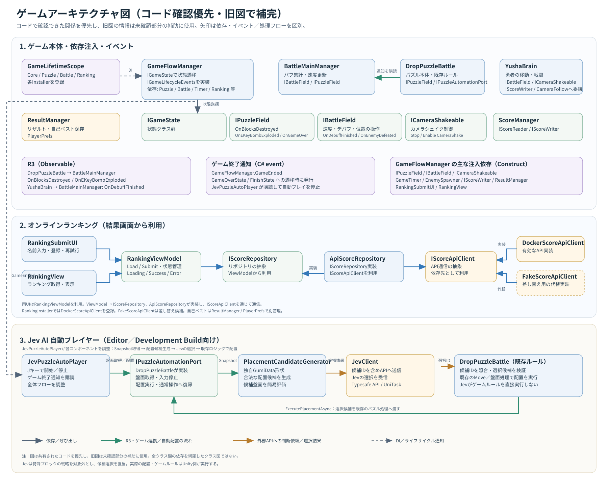

# 90秒スコアアタック × NavMesh連動 落下パズルバトル

## 📌 この作品について

**Unityで開発した、落下パズルの結果が勇者の戦闘に影響する90秒間のスコアアタックゲームです。**

NavMeshAgentによる自動戦闘と、プレイヤーが操作する落下パズルを組み合わせ、パズルの結果によって勇者を強化しながら敵の討伐数を競います。

ゲームの完成に加え、開発中に直面した設計上の課題を見直し、オンラインランキングやJev AIによる自動プレイにも取り組みました。

### 主な取り組み

- **ゲーム開発：** 自動戦闘、落下パズル、特殊ブロック、スコア管理などの実装。
- **設計改善：** VContainerによる依存性注入、インターフェースによる責務の分離、R3によるイベント通知を導入。
- **オンラインランキング：** API通信とランキング処理を分離し、通信実装を差し替えられる構成を設計。
- **Jev AIによる自動プレイ：** 独自のパズル形状に対応した配置候補を生成し、AIの選択を既存のゲーム処理につなぐ仕組みを実装。
- **技術検証：** 別リポジトリ「Otamesi」で設計パターンやUnity向け技術を検証し、ゲーム本体の改善に活用。

**ゲームを完成させるだけでなく、機能追加で生じた課題を見直し、実装と設計の両面から改善に取り組んだ作品です。**

---

## 🎮 ゲーム概要

| 項目 | 内容 |
| --- | --- |
| 開発環境 | Unity 2022.3 / C# |
| 開発開始 | 2025年2月26日 |
| ゲーム形式 | 2画面構成のアクションパズルゲーム |
| プレイ時間 | 90秒 |
| スコア | 敵の討伐数 |

### 🎮 操作方法

#### 通常プレイ

| キー | 操作 |
| `A` | ブロックを左に移動 |
| `D` | ブロックを右に移動 |
| `W` | ブロックを回転 |
| `S` | ブロックを高速落下 |
| `E` | EKeyBombを使用 |

通常時はブロックが自動で落下します。
ブロックを左右に動かしたり、回転させたりして配置を調整します。

### ゲームの目的

制限時間90秒の間に、できるだけ多くの敵を倒してスコアを稼ぐゲームです。

画面左では勇者が敵を自動で追跡・攻撃し、画面右ではプレイヤーが落下パズルを操作します。ブロックを消すと勇者が強化され、特殊ブロックを使うと戦闘に別の影響を与えられます。

### 基本的なゲームループ

1. タイトル画面からゲームを開始。
2. 落下パズルを操作してブロックを消す。
3. パズルの結果に応じて勇者を強化し、敵を倒す。
4. 制限時間終了後、敵の討伐数をスコアとして表示。
5. 結果を確認し、リトライまたはタイトルへ戻る。

---

## 🛠️ 使用技術

| 技術 | 用途 |
| --- | --- |
| Unity 2022.3 | ゲーム開発環境 |
| C# | ゲームロジックの実装 |
| NavMeshAgent | 勇者の自動移動・敵の追跡 |
| VContainer | 依存性注入・依存関係の管理 |
| R3 | イベント通知・状態変化の通知 |
| UniTask | 非同期処理 |
| ScriptableObject | ゲーム内設定値の管理 |
| UnityWebRequest | オンラインランキングのHTTP通信 |
| Docker | ランキングAPIサーバーの起動・動作確認 |
| Newtonsoft.Json | JSONデータの処理 |
| Jev AI | パズルの配置候補の選択・自動プレイ |
| Git | バージョン管理 |

※ゲーム本体で使用している技術と、別リポジトリ「Otamesi」で検証している技術は区別しています。

---

## ⚔️ 主なゲーム機能

### 1. NavMeshAgentによる勇者の自動戦闘

NavMeshAgentを利用して、勇者が敵を追跡・攻撃する仕組みを実装しました。

- 敵を検索し、対象に向かって移動。
- 攻撃可能な距離まで近づくと攻撃。
- 攻撃アニメーションと連動した敵の撃破処理。
- 敵の討伐数をスコアに反映。
- カメラシェイクによる攻撃演出。

プレイヤーがパズルを操作している間も勇者が戦闘を進めることで、2つのゲーム要素が同時に進行する構成にしています。

### 2. 独自の落下パズル

独自のブロック形状を使用した落下パズルを実装しています。

- ブロックの移動・回転・落下。
- 横一列の消去処理。
- ブロック消去に応じた勇者の強化。
- 特殊ブロックによる追加効果。
- ブロック消去後の盤面処理。

### 3. 特殊ブロック

通常のブロックとは異なる効果を持つ特殊ブロックを実装しています。

- **CrossBomb：** 十字方向にブロックを消去する爆弾。連鎖的な消去にも対応。
- **EKeyBomb：** Eキーで使用する爆弾。周囲5×5の範囲を消去し、勇者にデバフを与える。

### 4. バフ・デバフ管理

パズルの結果や特殊ブロックの使用に応じて、勇者の能力を変化させます。

- ブロック消去による移動速度の強化。
- EKeyBombによる移動速度の低下。
- 強化・弱体化の状態に応じた演出。
- デバフ終了後の状態復帰。

開発中、デバフ状態の管理が複数のクラスに分散していたため、状態管理の責務を整理しました。

勇者側でデバフ状態を管理し、終了通知を受け取った側が必要な処理を行う構成にすることで、同じ状態を複数のクラスで重複して管理しないよう改善しています。

### 5. ゲーム進行管理

ゲーム全体の進行を状態ごとに分けて管理しています。

主な状態：

- `TitleState`
- `ManualState`
- `CountdownState`
- `PlayingState`
- `GameOverState`
- `FinishState`
- `ResultState`
- `RankingSubmitState`
- `RankingViewState`

タイトル、カウントダウン、プレイ中、終了、結果表示、ランキング登録・表示などの状態を分離し、ゲーム進行の責務を整理しています。

---

## 🏗️ 設計改善・アーキテクチャ

### アーキテクチャ図

主要なクラス、インターフェース、依存性注入、イベント通知、オンラインランキング、Jev AIの連携を図にまとめています。

※主要な依存関係と連携経路を示した図です。すべてのクラスやメソッドを網羅したクラス図ではありません。

### 改善に取り組んだ背景

開発初期はゲームを完成させることを優先していましたが、機能を追加するにつれて、クラス間の依存関係や責務の重複が課題になりました。

そこで、機能の追加・変更時に修正箇所を把握しやすい構成を目指し、依存関係や状態管理の見直しに取り組みました。

### 1. VContainerによる依存性注入

VContainerを導入し、依存関係の登録とオブジェクトへの注入を整理しました。

- `LifetimeScope` による依存関係の登録。
- 機能ごとのInstallerによる登録処理の整理。
- 注入メソッドを利用した依存関係の明示。
- インターフェースを介した依存関係の整理。

依存関係を各クラス内で直接生成・取得するのではなく、登録箇所を通じて把握しやすくすることを意識しています。

### 2. インターフェースによる責務の分離

機能間の依存を整理するため、用途に応じたインターフェースを導入しました。

| インターフェース | 役割 |
| --- | --- |
| `IPuzzleField` | パズル側の機能へのアクセスを抽象化 |
| `IBattleField` | 戦闘側の機能へのアクセスを抽象化 |
| `IScoreReader` | スコアの参照 |
| `IScoreWriter` | スコアの更新 |

呼び出し側が具体クラスの実装詳細に依存しすぎないよう、必要な操作をインターフェースとして定義しています。

### 3. R3によるイベント通知

パズルと戦闘など、異なる機能間の状態変化の通知にR3を利用しています。

- ブロック消去やEKeyBombの発動を通知し、購読側で必要な処理を実行。
- 勇者のデバフ終了などのイベントをObservableとして公開。
- イベントの発生元と通知先の直接的な結びつきを減らす。
- 状態変化に応じた処理を購読側に分ける。
- オブジェクトの破棄時に購読を解除し、Subjectなどのライフサイクルを管理する。

イベントの発生元が通知先の具体的な処理をすべて知る必要がない構成を目指しました。

### 4. ScriptableObjectによる設定の分離

ゲーム内の調整値をコードから分離するため、ScriptableObjectを利用しています。

主な設定データ：

- `YushaSettingSO`
- `BattleSettingSO`
- `EnemySettingSO`
- `CameraSettingSO`
- パズル関連の設定データ

勇者の移動速度や攻撃距離などの調整値を処理の実装から分離し、ゲームバランスを調整しやすい構成にしています。

### 5. Singletonに対する考え方

Singletonを一律に否定するのではなく、共有状態や依存関係の管理方法を検討したうえで、適切な使い分けを意識しています。

OtamesiではSingletonを含む設計パターンを検証し、VContainerによる依存性注入との違いや使いどころを学びました。

ゲーム本体ではVContainerによって依存関係を登録・注入する構成を採用しています。設計パターンを機械的に適用するのではなく、導入によって何が改善され、どのような制約が生じるのかを考えることを重視しています。

---

## 🌐 オンラインランキング

外部APIと連携し、スコアの登録・取得を行うオンラインランキング機能を実装しています。

### 主な構成

| クラス・インターフェース | 役割 |
| --- | --- |
| `IScoreRepository` | ランキングデータの取得・登録を抽象化 |
| `ApiScoreRepository` | APIクライアントを利用したランキング処理 |
| `IScoreApiClient` | API通信処理の抽象化 |
| `DockerScoreApiClient` | Dockerで起動するAPIサーバーとの通信 |
| `FakeScoreApiClient` | 通信実装を差し替えた動作確認に使用 |

### 設計上の工夫

ランキング画面がHTTP通信の詳細を直接扱わないように、ランキング処理と通信処理を分離しています。

- API通信をインターフェース経由で利用。
- 通信実装を差し替えられる構成。
- Fake実装を利用した動作確認。
- `UnityWebRequest` を利用したHTTP通信。
- UniTaskを利用した非同期処理。

通信処理の詳細を画面側に持たせないことで、ランキング機能の責務を整理しています。

ローカルで記録する自己ベストとオンラインランキングを分け、それぞれの役割を区別しています。

---

## 🤖 Jev AIによるパズル自動プレイ

Jev AIを利用し、独自の落下パズルを自動で操作する仕組みを実装しています。

**AIにゲーム内部を直接操作させるのではなく、Unity側で配置候補を生成し、AIに候補を選択させてから既存のゲーム処理で実行する構成です。**

### 🎮 操作方法

| キー | 操作 |
| `Tab` | Jev AIの操作UIを表示・非表示に切り替える |
| `J` | Jev AIによる自動プレイの開始・停止 |

#### 操作手順

1. ゲームを起動する。
2. `Tab` キーでJev AIの操作UIを表示する。
3. `J` キーで自動プレイを開始する。
4. 自動プレイ中は、Jev AIが配置候補を選択し、Unity側で検証・実行する。
5. 停止する場合は、もう一度 `J` キーを押す。

### ⚙️ 使用条件

- 自動プレイ機能はUnity EditorまたはDevelopment Buildでの動作を想定しています。
- Jev APIを利用するため、APIキーの設定が必要です。
- APIキーは環境変数 `TYPESAFE_API_KEY` から取得します。
- APIとの通信にはネットワーク接続が必要です。

APIキーはソースコードやREADMEに直接記載せず、環境変数を利用して管理しています。

### 🔄 処理の流れ

1. 現在の盤面情報を取得する。
2. Unity側で独自のパズル形状に対応した配置候補を生成する。
3. 盤面情報と配置候補をJev APIに送信する。
4. Jev AIが与えられた候補から1つを選択し、候補IDを返す。
5. Unity側で選択結果を対応する配置候補に変換する。
6. 選択された候補が実行可能か検証する。
7. 既存のパズル操作処理を利用して配置を実行する。
8. 盤面処理が完了し、次のピースが生成されたら、次の判断を開始する。

### 🏗️ 実装上の工夫

#### 1. AIの判断とゲーム内処理の分離

AIにはゲーム内部のオブジェクトを直接操作させず、Unity側で生成した配置候補の中から選択させています。

AIの回答をそのままゲームに適用するのではなく、Unity側で候補を照合・検証してから実行します。

#### 2. 配置候補の生成を独立

独自のパズル形状に対応した配置候補の生成処理を分離し、AIによる判断処理と実際の配置処理を区別しています。

これにより、配置候補の生成方法やAIによる選択方法を、それぞれ独立して改善しやすい構成を目指しています。

#### 3. インターフェースによるパズル本体との連携

自動プレイヤーとパズル本体の間に `IPuzzleAutomationPort` を設けています。

盤面情報の取得、自動配置の実行、通常操作との調整などをインターフェース経由で行うことで、自動プレイヤーがパズル本体の具体的な内部処理に直接依存しない構成にしています。

#### 4. 非同期処理とキャンセルへの対応

Jev APIとの通信には非同期処理を使用し、キャンセル要求を扱える構成にしています。

ゲーム終了時には自動プレイを停止し、ゲームの進行とAIによる判断処理が独立して暴走しないようにしています。

### 📌 現在の実装範囲

現在は、配置候補の生成、Jev AIによる候補選択、選択結果の検証、既存のゲーム処理を利用した自動配置を中心に実装しています。

特殊ブロックの効果を考慮した戦略や、長期的なプレイ結果に基づくゲームバランスの自動分析は、現在の実装範囲には含めていません。

### 🚀 今後の改善課題

今後は、自動プレイをゲームバランスの検討にも活用できるよう、次の改善に取り組みたいと考えています。

- プレイ結果や配置履歴の記録。
- 条件を変えた自動プレイの比較。
- 配置候補の評価方法の改善。
- 長期的なプレイ結果に基づくゲームバランスの検討。
- 通信失敗や不正な回答が発生した場合の動作確認。

AIをゲームに組み込むだけでなく、自動プレイの結果を分析し、ゲームの改善に活用できる仕組みへ発展させることを目指しています。

---

## 🧪 Otamesi：技術検証用リポジトリ

リポジトリ：[Otamesi](https://github.com/seiya0417soccer-jpg/otameshi)

ゲーム本体とは別に、Unity開発で利用する技術や設計パターンを試すためのリポジトリです。

### 主な検証内容

- **依存性注入：** VContainer
- **イベント通知：** R3
- **非同期処理：** UniTask
- **API連携：** UnityWebRequest、Dockerで起動するAPIサーバーとの連携
- **JSON処理：** Newtonsoft.Json
- **設計パターン：** Singleton、Factory、Builder、Strategy、Memento、Object Pool、Facade、Command、State
- **AI連携：** Jevを利用した技術検証

### 取り組みの目的

技術や設計パターンを名前だけで理解したつもりになるのではなく、小さな実装を通じて動作や使いどころを確認することを目的としています。

検証した技術のうち、ゲーム本体で役立つものについては、実際の機能や依存関係の改善に活用しています。

※すべての技術・設計パターンをゲーム本体に導入しているわけではありません。Otamesiは、個別の技術検証を行うための別プロジェクトです。

---

## 👥 チーム開発での経験

別のゲーム開発では、既存コードを理解しながら機能を追加・改善する経験をしました。

### 主な取り組み

- 既存のクラス構成や処理の流れを調査。
- 既存機能への影響を意識した変更。
- Gitのブランチを利用した作業。
- ルーム番号のコピー・貼り付けUIや、Steamのフレンド招待に関係する機能の改善。

既存コードに機能を追加する際は、既存の役割と依存関係を把握したうえで、必要な範囲から変更することを意識しました。

※通信基盤そのものの開発と、既存の通信機能を利用したUI・機能の改善は区別して記載しています。

---

## 🧠 AIを活用した開発

開発中は、AIをコードの生成だけでなく、調査や理解、設計の検討にも利用しています。

### 主な利用方法

- 実装方針やAPIの調査。
- 既存クラスの役割や処理の理解。
- コードのたたき台の作成。
- 設計や依存関係のレビュー。
- エラーの原因調査と修正案の検討。

生成されたコードをそのまま採用するのではなく、プロジェクトの構成や目的に合っているかを確認し、必要に応じて修正しています。

AIを利用する場合でも、実装内容を理解し、なぜその設計を選ぶのかを説明できることを重視しています。

---

## 🚀 今後の改善予定

### Jev AI・ゲームバランス検証

- プレイ結果の記録と比較。
- 配置候補の評価方法の改善。
- 条件を変えた自動プレイによるバランス検討の支援。

### 設計・品質

- 機能間の依存関係の継続的な見直し。
- テストや動作確認の充実。
- 変更時の影響範囲を把握しやすい構成への改善。

---

## 🔗 関連リポジトリ

- **技術検証用：** [Otamesi](https://github.com/seiya0417soccer-jpg/otameshi)

VContainer、R3、UniTaskなどの技術や設計パターンを個別に検証し、ゲーム本体の設計改善にも活用しているリポジトリです。